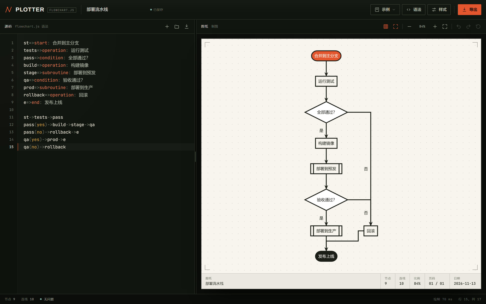
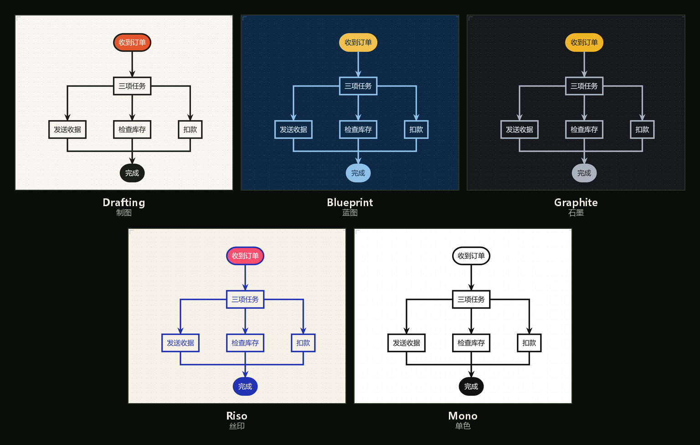

# Plotter

**flowchart.js DSL 的本地绘图台。**

写代码，实时出图；拖节点，改连线；换主题，导出 SVG / PNG / JPEG。

**在线体验：<https://rdh4451.github.io/flowchart.js-plotter/>** —— 不用安装，打开浏览器就能用。

<p>
  <a href="https://rdh4451.github.io/flowchart.js-plotter/"></a>
  
  <a href="https://github.com/RDH4451/flowchart.js-plotter/stargazers"></a>
  
  
  
  
</p>

<p align="center">
  
</p>

<p align="center"><sub>左侧写 DSL，右侧实时出图；底部状态栏显示节点、连线、问题数和光标位置。</sub></p>

Plotter 是一个面向 [flowchart.js](https://github.com/adrai/flowchart.js) DSL 的静态流程图编辑器。左侧是带行号和高亮的源码编辑器，右侧是实时渲染的图纸。你既可以只改文本，也可以直接在图纸上拖动节点、调整连线、切换主题，最后导出为 SVG、PNG 或 JPEG。

它不需要安装依赖，不需要构建，也不会上传你的源码。双击 `index.html` 就能用，或者把整个目录放到 GitHub Pages、任意静态服务器上。

不想下载？直接打开 [在线演示](https://rdh4451.github.io/flowchart.js-plotter/) 就能体验，功能和本地版完全一致。

> Plotter 是 flowchart.js 的非官方配套工具，与上游项目没有隶属关系。

## 目录

- [为什么用它](#为什么用它)
- [功能特性](#功能特性)
- [快速开始](#快速开始)
- [界面导览](#界面导览)
- [使用指南](#使用指南)
- [快捷键](#快捷键)
- [flowchart.js 语法速查](#flowchartjs-语法速查)
- [项目结构](#项目结构)
- [技术实现](#技术实现)
- [数据与隐私](#数据与隐私)
- [已知限制](#已知限制)
- [尚未实现](#尚未实现)
- [浏览器支持](#浏览器支持)
- [开发与贡献](#开发与贡献)
- [常见问题](#常见问题)
- [许可证与致谢](#许可证与致谢)

## 为什么用它

- **文本和图形在同一个页面。** 源码是主体，图形操作只改必要的地方，不会把整份文件重写一遍。
- **从草稿到导出不用换工具。** 写、看、调、导出都在一个界面里完成。
- **本地、离线、无账号。** 应用运行时不发起网络请求，适合内网、飞机上或不想登录的场景。
- **轻。** 没有 npm、没有打包器、没有运行时框架，静态托管即可。

适合写技术方案、README 配图、流程说明、教学示例，或者临时画一张能继续用代码维护的图。

## 功能特性

### 编辑

- 行号、当前行高亮、flowchart.js 语法高亮。
- 自动缩进、`Tab` 插入两个空格、注释切换。
- 边写边渲染；以 `//` 或 `#` 开头的行在渲染前移除，并在编辑器里变暗。
- 从 9 种节点模板插入节点，自动生成不重复的节点名。
- 打开和下载 `.flow` 源码；也接受 `.fchart`、`.txt`、`.md` 等文本文件。

### 校验

- 检查格式错误、重复节点名、未知节点类型、未知节点引用、坏箭头、条件分支缺失或重复、结束节点出边、自环、未知方向和孤立文本。
- 对拼写接近的节点类型或节点名给出建议，例如把 `operaton` 提示为 `operation`。
- 提示不可达节点；超过 6 个时汇总剩余数量。
- 问题按“错误优先、行号其次”排序，显示在诊断面板和状态栏；点击条目可跳到对应行。
- 源码有错时保留上一张成功的图，并标记“待更新”；此时导出会被禁用，避免导出过期内容。

### 布局与图纸

- 默认自顶向下分层布局，带交叉减少、正交路由、障碍物绕行和并行通道分离。
- 连线交叉处可显示跨线小弧，也可以关掉。
- 拖动节点、按住 `Shift` 多选、在空白处拖拽框选、水平/垂直等距分布。
- 拖动时自动对齐吸附；按住 `Alt` 临时关闭吸附。
- 连线可选中、改起点/终点所在的边、简化折点、恢复自动路由、隐藏。
- 拖空白平移，`Ctrl/⌘ + 滚轮` 缩放，也可以用缩放按钮和“适应视图”；双击空白处适应图纸。
- 网格和图纸边框可以独立开关。
- 手动位置和连线路径会随文档保存。

### 主题与排版

- 五套图纸主题：制图、蓝图、石墨、丝印、单色。
- 图纸字体：无衬线、衬线、等宽、系统界面。
- 字号 10–24、线宽 1–6、节点间距 24–90、内边距 4–24。
- 箭头样式：经典、方块、宽长、椭圆。
- 自定义“是/否”分支标签；可开关绘制动画和跨线弯。

<p align="center">
  
</p>

<p align="center"><sub>同一张图在五套主题下的效果：Drafting、Blueprint、Graphite、Riso、Mono。</sub></p>

### 导出

- **SVG**：矢量，保留可点击链接；带 `[blank]` 的链接会加 `target="_blank"`。
- **PNG**：1× / 2× / 3×，支持图纸、透明、白色三种背景。
- **JPEG**：1× / 2× / 3×，固定白色背景。
- 边距 0–96 px；导出前在对话框里显示实际像素尺寸。
- **复制**：SVG 复制源码文本；PNG/JPEG 复制为 PNG 图片。复制需要安全上下文（HTTPS 或 localhost）。

### 文件与恢复

- `.flow` 是纯文本，可以直接进 Git、做 diff、贴进 issue。
- 当前文档自动保存到 `localStorage`，键名 `plotter.state.v1`。
- 撤销/重做覆盖源码编辑、节点移动和连线调整，最多 100 步；不覆盖主题、样式和导出设置。
- 手动布局、连线路径和隐藏连线写在文件末尾的 `// @plotter {...}` 注释里。不要手动删这行，否则这些调整会丢失。

## 快速开始

### 在线使用

打开 <https://rdh4451.github.io/flowchart.js-plotter/>，不需要下载、安装或登录。这是本仓库 `main` 分支通过 GitHub Pages 自动部署的版本，和本地版完全一致。

### 本地打开

```bash
git clone https://github.com/RDH4451/flowchart.js-plotter.git
```

下载或 clone 后双击 `index.html`。应用不依赖服务器，`file://` 也能运行。如果浏览器限制了本地文件访问，改用下面的本地服务器。

### 本地服务器

```bash
# Python 3
python -m http.server 8000

# Node.js，不需要安装依赖
npx serve .
```

然后打开 <http://localhost:8000/>。

### 部署到 GitHub Pages

本仓库已经启用 Pages，每次推送 `main` 都会自动重新构建并发布到 <https://rdh4451.github.io/flowchart.js-plotter/>。

Fork 或复制本仓库后，按下面的步骤启用你自己的站点：

1. 把仓库推送到 GitHub。
2. 打开 **Settings → Pages → Build and deployment**。
3. Source 选择 **Deploy from a branch**，分支选 `main`，目录选 `/ (root)`，保存。
4. 等 Pages 构建完成，访问 `https://<用户名>.github.io/<仓库名>/`。

仓库已经包含 `.nojekyll`，不需要额外配置。

## 界面导览

| 区域 | 能做什么 |
| --- | --- |
| 顶栏 | 修改文档标题；查看保存状态；打开示例、语法参考、样式面板和导出对话框 |
| 源码面板 | 编写 DSL；行号、高亮、自动缩进；插入节点；打开和下载源码 |
| 图纸面板 | 实时预览；网格/边框开关；缩放/适应；撤销/重做；重置手动布局 |
| 诊断面板 | 列出错误和警告；点击条目跳到对应行；可整体隐藏 |
| 状态栏 | 节点数、连线数、问题数、渲染耗时、光标行列 |
| 图纸标题栏 | 文档标题、节点/连线数、当前比例、页码、日期 |
| 连线工具栏 | 修改起点/终点所在的边；简化折点；恢复自动路由；隐藏连线 |
| 节点工具栏 | 多选 3 个以上节点时，水平或垂直等距分布 |

## 使用指南

### 1. 写第一个流程图

```text
st=>start: 开始
in=>input: 你的想法
op=>operation: 起草
cond=>condition: 够好了吗？
fix=>operation: 修改
out=>output: 发布
e=>end: 完成

st->in->op->cond
cond(no)->fix->op
cond(yes)->out->e
```

规则：

- 定义写成 `name=>type: label`，冒号后面要有空格。
- 节点名不能包含空格；标签写在冒号后面。
- 连线用 `->`。
- 条件节点用 `(yes)` / `(no)` 分支；并行节点用 `(path1)` / `(path2)` / `(path3)`。

### 2. 在图纸上调整

- 拖动节点：写入手动布局。
- `Shift` + 点击：多选；`Shift` + 拖空白：框选。
- 拖动空白：平移；`Ctrl/⌘ + 滚轮`：缩放；双击空白：适应图纸。
- 按住 `Alt` 拖动：临时关闭对齐吸附。
- 选中连线：改端口、简化折点、恢复自动路由或隐藏。

手动布局是绝对坐标，换主题、改字号或调整窗口大小都不会自动重排。想回到自动布局，点击图纸工具栏里的“重置手动调整与隐藏连线”。

### 3. 处理校验提示

诊断面板会按行号列出问题；点击一条会跳到源码对应位置。出错时，画布保留上一张成功的图，并显示“待更新”标记。修好语法后会自动重新渲染。

### 4. 换主题和样式

顶栏的“样式”打开“墨水与字体”面板。主题只影响图纸，不影响编辑器。字号、线宽、节点间距、内边距、箭头样式和分支标签都在这里调整。

### 5. 导出

点击“导出”，或按 `Ctrl/⌘ + Shift + E`。选择：

- **格式**：SVG / PNG / JPEG。
- **分辨率**：位图才能选 1× / 2× / 3×。
- **背景**：图纸、透明（PNG）或白色。
- **边距**：0–96 px。
- **保留链接**：仅 SVG。

对话框会显示输出尺寸。SVG 适合继续编辑或放大；PNG 适合文档和透明背景；JPEG 适合体积更小的白底图。

### 6. 保存与恢复

- `Ctrl/⌘ + S` 下载 `.flow` 源码。
- 源码面板的文件夹按钮打开文本文件。
- 当前文档会自动保存在浏览器 `localStorage` 里。
- 换浏览器、清站点数据或使用隐私窗口会丢失自动保存；重要图纸请保存成 `.flow`。

## 快捷键

| 快捷键 | 作用 |
| --- | --- |
| `Ctrl/⌘ + Enter` | 立即重新渲染 |
| `Ctrl/⌘ + S` | 下载 `.flow` 源码 |
| `Ctrl/⌘ + Shift + E` | 打开导出对话框 |
| `Ctrl/⌘ + /` | 注释或取消注释当前行/选区 |
| `Ctrl/⌘ + Z` | 撤销 |
| `Ctrl/⌘ + Shift + Z` / `Ctrl/⌘ + Y` | 重做 |
| `Delete` / `Backspace` | 隐藏选中的连线，不改源码 |
| `Tab` | 插入两个空格 |
| `Esc` | 关闭弹层/对话框，取消拖拽，清除图纸选中 |
| `←` / `→` | 分隔条获得焦点时调整左右宽度 |

图纸上的鼠标操作：

| 操作 | 效果 |
| --- | --- |
| 拖动空白 | 平移画布 |
| 拖动节点 | 移动节点，写入手动布局 |
| `Shift` + 点击节点 | 多选 |
| `Shift` + 拖空白 | 框选 |
| `Alt` + 拖动 | 临时关闭对齐吸附 |
| `Ctrl/⌘ + 滚轮` | 缩放 |
| 双击空白 | 适应图纸 |

## flowchart.js 语法速查

### 节点类型

| 类型 | 说明 |
| --- | --- |
| `start` | 流程起点 |
| `end` | 流程终点 |
| `operation` | 普通步骤或动作 |
| `inputoutput` | 输入/输出 |
| `input` | 仅输入 |
| `output` | 仅输出 |
| `subroutine` | 子流程 |
| `condition` | 条件分支 |
| `parallel` | 并行分支 |

### 定义与连线

```text
st=>start: 开始
op=>operation: 处理
cond=>condition: 通过？
e=>end: 结束

st->op->cond
cond(yes)->e
cond(no)->op
```

方向提示写在括号里：

```text
cond(yes, right)->e
para(path1, bottom)->a
para(path2, right)->b
para(path3, left)->c
```

### 标签、状态与链接

```text
op=>operation: 第一行
标签的第二行
op=>operation: 文档|current:>https://example.com[blank]
```

可用状态：`past`、`current`、`future`、`approved`、`rejected`、`invalid`。

链接写在标签后面，`[blank]` 表示在新窗口打开。

### 高亮路径

```text
st@>op({"stroke":"#e4572e"})@>e({"stroke-width":6})
```

`@>` 后面接受任意 Raphael 属性的 JSON。每条路径写一行。

### 注释

以 `//` 或 `#` 开头的行会在渲染前移除，并在编辑器里变暗。flowchart.js 本身没有注释语法，这是 Plotter 提供的便利。

文件末尾的 `// @plotter {...}` 是 Plotter 的布局元数据，用来保存手动位置、连线路径和隐藏连线。可以保留在 Git 里，但不要手动编辑。

## 项目结构

| 路径 | 说明 |
| --- | --- |
| `index.html` | 页面骨架、SVG 图标、弹层/对话框、语法参考 |
| `styles.css` | 布局、五套主题、响应式规则 |
| `fonts.css` | 本地 `@font-face` 声明 |
| `js/app.js` | 状态、编辑器、布局、连线编辑、渲染、导出 |
| `js/lint.js` | DSL 校验、注释剥离、拼写建议 |
| `vendor/` | flowchart.js 1.17.1 + Raphael 2.3.0 |
| `fonts/` | Archivo + JetBrains Mono 可变字体（WOFF2）及 OFL 许可证 |
| `favicon.svg` | 应用图标 |
| `screenshot.png` | 主界面截图 |
| `screenshot-themes.png` | 五套主题对比图 |
| `LICENSE` | MIT 许可证 |
| `THIRD_PARTY_NOTICES.md` | 第三方组件版本、版权和许可证 |

## 技术实现

| 部分 | 实现 |
| --- | --- |
| DSL 解析 | [flowchart.js](https://github.com/adrai/flowchart.js) 1.17.1 |
| SVG 渲染 | [Raphael](https://dmitrybaranovskiy.github.io/raphael/) 2.3.0 |
| 应用逻辑 | 原生 JavaScript（单 IIFE，无框架） |
| 样式 | 原生 CSS 变量 + 五套主题 |
| 校验 | 自研轻量校验器 `js/lint.js` |
| 持久化 | `localStorage` + `.flow` 文本 |
| 构建 | 无；静态文件直接部署 |
| 字体 | Archivo / JetBrains Mono，本地 WOFF2 |

### 设计取舍

- **无构建。** 下载即用，部署简单，也能直接跑在 `file://` 上。代价是应用代码集中在一个闭包里，改动时需要更小心。
- **文本优先。** 源码是唯一事实来源。只有重接连线端点时才回写 DSL，其余视觉调整存为元数据，避免意外改动文本。
- **本地优先。** 没有账号、后端和网络请求。代价是跨设备同步要手动拷贝 `.flow`。
- **保留上一张好图。** 语法错误时不清空画布，用“待更新”标记提醒。代价是预览可能短暂过期。

## 数据与隐私

- 解析、渲染、导出全部在浏览器本地完成。
- 不上传源码，不发起网络请求；依赖和字体都在仓库里。
- `localStorage` 只保存当前文档、主题、样式、手动布局和导出设置。
- 打开文件使用浏览器 `FileReader`，不会写回原文件。
- 清除站点数据会丢失自动保存；重要文档请保存成 `.flow`。

## 已知限制

- 单文档，没有标签页或多文档切换。
- `localStorage` 会因清站点数据、换浏览器或隐私窗口而丢失。
- 文件末尾的 `// @plotter` 行可能被其他 flowchart.js 工具重写时删掉。
- flowchart.js 的普通节点只能有一条 `next` 出边；多余的边会被渲染器丢弃，Plotter 会给出提示。
- 手动布局是绝对坐标，不随窗口、字号或主题变化自动重排。
- 3× 超大图可能触及浏览器的 canvas 或 SVG 光栅化上限。
- 剪贴板复制需要安全上下文（HTTPS 或 localhost）。
- 图纸不支持纯键盘编辑。
- 界面只有简体中文。
- 没有自动化测试，校验和路由主要靠手动验证。

## 尚未实现

- 多文档或标签页。
- 账号、云同步、协作。
- 从 Mermaid、PlantUML、Graphviz 或 draw.io 导入。
- PDF 导出。
- 主题、字体或窗口变化后的自动重排。
- 主题、样式和导出设置的撤销。
- flowchart.js 之外的自定义节点形状。
- 纯键盘的画布编辑。
- 简体中文之外的语言。
- 服务端渲染或 CLI。

## 浏览器支持

当前版本的 Chrome、Edge、Firefox 和 Safari。

需要 SVG、`localStorage` 和 `<dialog>`；导出需要 canvas 光栅化；复制到剪贴板需要安全上下文（HTTPS 或 localhost）。

## 开发与贡献

没有 `package.json`，也没有构建步骤。改完文件刷新浏览器即可。

- **新增示例**：编辑 `js/app.js` 里的 `EXAMPLES`。
- **新增主题**：编辑 `js/app.js` 里的 `THEMES`，再在 `styles.css` 里补对应规则。
- **新增校验规则**：编辑 `js/lint.js`。
- **改界面**：`index.html` + `styles.css`，保持现有的 CSS 变量和响应式断点。

提交前建议手动检查：

1. 写一段有语法错误的源码，确认诊断面板出现提示、画布保留上一张图。
2. 条件分支和并行分支都能正确连线和显示。
3. 拖动节点、框选、撤销/重做正常。
4. 导出 SVG、PNG（透明/图纸）和 JPEG 各一次。
5. 窄屏下“代码/图纸”切换正常。

欢迎 [issue](https://github.com/RDH4451/flowchart.js-plotter/issues) 和 [PR](https://github.com/RDH4451/flowchart.js-plotter/pulls)。请尽量保持“无构建、无运行时外部依赖、离线可用”的约束，并在 PR 里附上复现步骤和浏览器版本。

如果这个项目对你有帮助，欢迎点一个 ⭐ Star，或把[在线版](https://rdh4451.github.io/flowchart.js-plotter/)分享给需要画流程图的人。

## 常见问题

**数据会上传到服务器吗？**

不会。应用没有后端，运行时也不发起网络请求。

**为什么普通节点只能连一条线？**

这是 flowchart.js 的限制。需要分支时请用 `condition`（`yes`/`no`）或 `parallel`（`path1`–`path3`）。

**为什么换了主题，手动布局没有重排？**

手动位置是绝对坐标。点击“重置手动调整与隐藏连线”回到自动布局，或删除文件末尾的 `// @plotter` 行。

**导出的 PNG 是空白？**

先检查源码是否有错误、图纸是否处于“待更新”。修好后重试；超大图可以降低导出倍率。

**复制按钮不可用？**

剪贴板需要 HTTPS 或 localhost。也可以直接下载文件。

**能直接用 `file://` 打开吗？**

可以。如果浏览器限制本地文件访问，用 `python -m http.server` 或 `npx serve .`。

## 许可证与致谢

Plotter 的原创代码以 [MIT License](LICENSE) 发布。

第三方组件：

- [flowchart.js](https://github.com/adrai/flowchart.js) 1.17.1 — Adriano Raiano — MIT
- [Raphael](https://dmitrybaranovskiy.github.io/raphael/) 2.3.0 — Dmitry Baranovskiy — MIT
- [Archivo](https://fonts.google.com/specimen/Archivo) — SIL Open Font License 1.1
- [JetBrains Mono](https://www.jetbrains.com/lp/mono/) — SIL Open Font License 1.1

完整版权声明和许可证文本见 [THIRD_PARTY_NOTICES.md](THIRD_PARTY_NOTICES.md)，以及 `vendor/`、`fonts/` 目录下的许可证文件。

---

## English

Plotter is a static, offline-first editor for the [flowchart.js](https://github.com/adrai/flowchart.js) DSL. Write a diagram as text on the left, get a live SVG preview on the right, adjust nodes and connectors directly, switch between five sheet themes, and export SVG, PNG, or JPEG.

**Try it online: <https://rdh4451.github.io/flowchart.js-plotter/>**

It runs from `index.html` with no build step, no backend, and no network requests. The UI is Simplified Chinese; flowchart.js keywords stay in English. MIT licensed. Not affiliated with or endorsed by the upstream flowchart.js project.

```bash
git clone https://github.com/RDH4451/flowchart.js-plotter.git
```

<p align="center">
  <a href="https://rdh4451.github.io/flowchart.js-plotter/">在线体验 Live demo</a> ·
  <a href="https://github.com/RDH4451/flowchart.js-plotter">源码 Source</a> ·
  <a href="https://github.com/RDH4451/flowchart.js-plotter/issues">问题反馈 Issues</a> ·
  <a href="LICENSE">MIT License</a>
</p>
